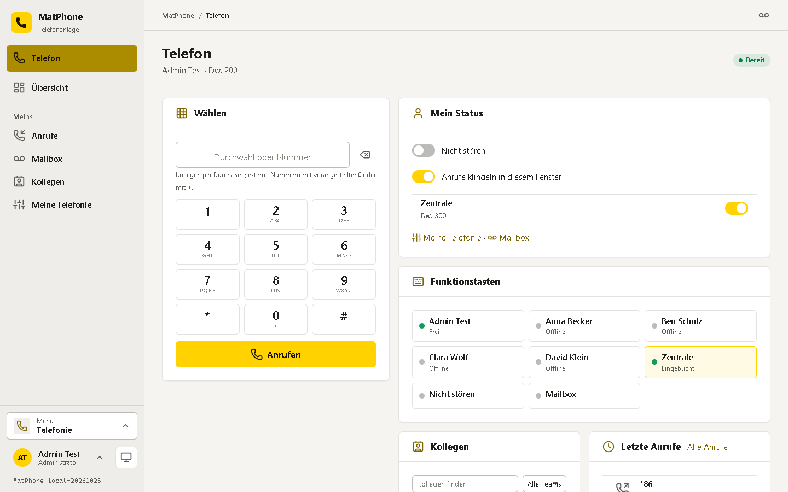
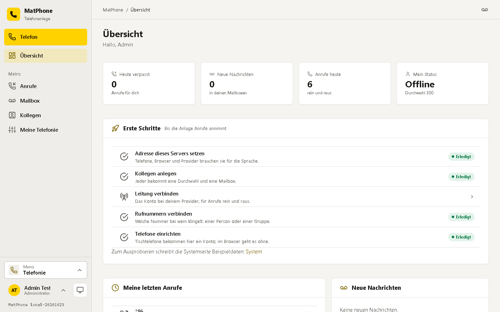
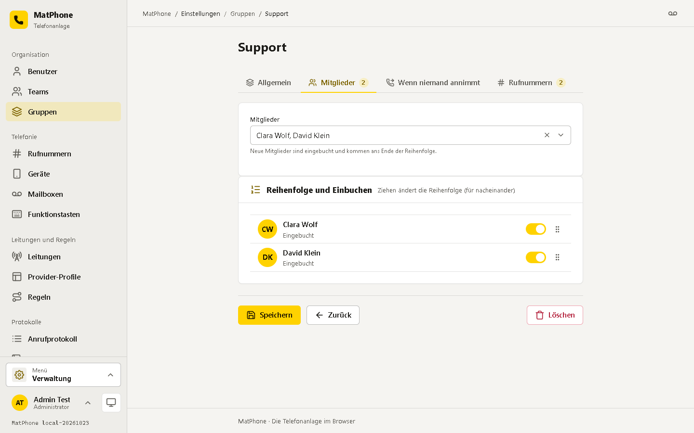
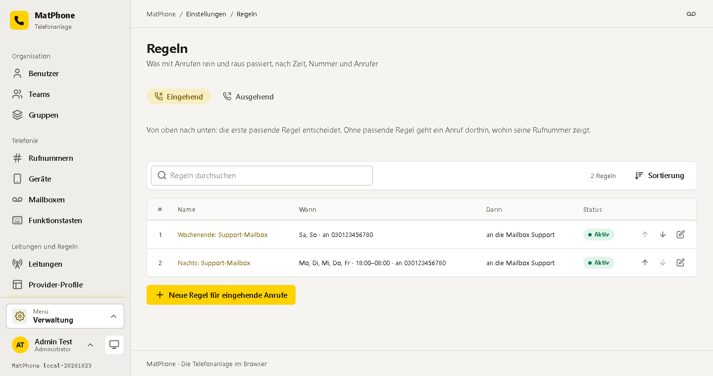
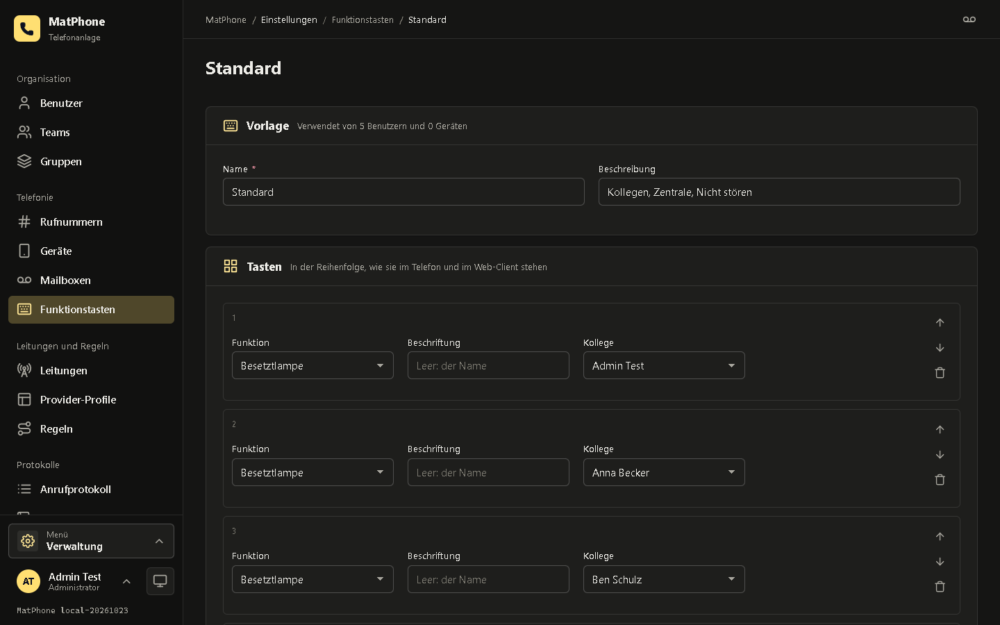
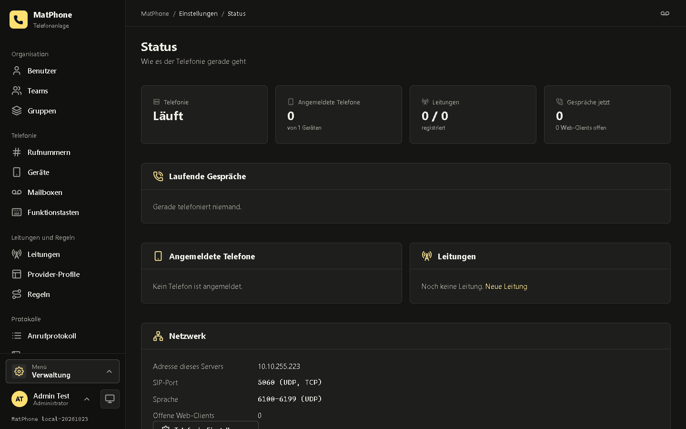
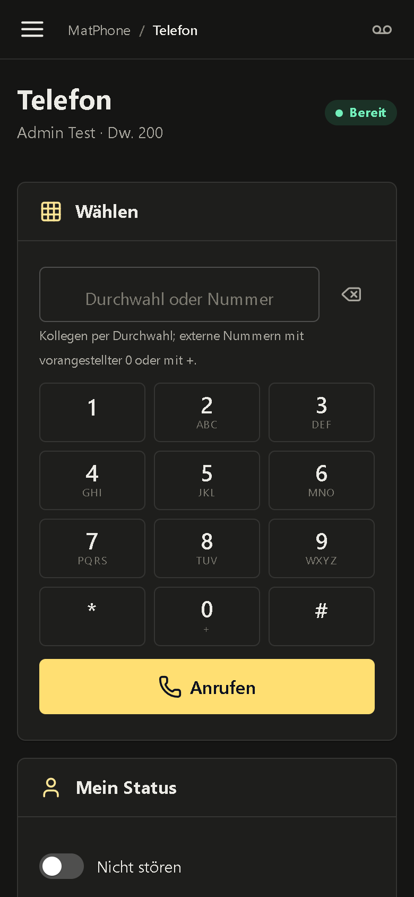

<div align="center">


# MatPhone

**Die Telefonanlage für kleine Firmen – im Browser, auf dem eigenen Server.**

Benutzer, Gruppen mit Klingelstrategie, Rufnummern, Tischtelefone, Mailboxen, Leitungen zu Telekom, peoplefone, Vodafone & Co.,
Regeln nach Zeit und Nummer, Funktionstasten und ein Telefon im Browser. Ein Container plus PostgreSQL, installierbar als App.

</div>



---

## Worum es geht

Eine kleine Telefonanlage, gedacht wie eine einfache Starface: Die Anlage steht im eigenen Netz, die Kollegen telefonieren mit
Tischtelefonen (SIP) oder direkt im Browser, und alles wird an einer Stelle eingerichtet – wer welche Nummer hat, welche Gruppe wann klingelt,
was nachts und am Wochenende passiert und welche Tasten auf dem Telefon liegen.

Die Telefonie ist reines C# ([SIPSorcery](https://github.com/sipsorcery-org/sipsorcery)): ein Back-to-Back-User-Agent, der Telefone,
Browser (WebRTC) und Provider-Leitungen verbindet. Kein Asterisk, kein FreeSWITCH, kein zweiter Container.

## Auf einen Blick

**Organisation**
- **Benutzer** mit Durchwahl, Mailbox, Umleitungen (immer / besetzt / nach Sekunden), „Nicht stören“ und eigener angezeigter Rufnummer
- **Teams** für die Übersicht der Kollegen, **Gruppen** mit Klingelstrategie: *alle gleichzeitig*, *nacheinander* oder *reihum*;
  Mitglieder buchen sich ein und aus (im Browser, per Funktionstaste oder Code `*85`), was keiner annimmt, geht an Mailbox, Kollege, Gruppe oder externe Nummer

**Telefonie**
- **Rufnummern:** interne Durchwahlen und externe Nummern (E.164), jeweils einem Benutzer, einer Gruppe, einer Mailbox oder einem externen Ziel zugeordnet
- **Geräte:** SIP-Tischtelefone und Softphones mit eigenem Konto (Passwort wird erzeugt), Registrierung mit Digest-Anmeldung, Schutz gegen SIP-Scanner
- **Mailboxen** pro Person oder Gruppe, mit eigener Ansage (im Browser aufnehmen oder WAV hochladen), Nachrichten im Browser anhören,
  per Mail zustellen, am Telefon mit `*86` abhören (PIN von fremden Telefonen)
- **Funktionstasten** als Vorlagen: Besetztlampenfeld (BLF) mit Anrufen und Heranholen, Kurzwahl, Gruppe ein/aus, Nicht stören, Umleitung, Mailbox –
  für Benutzer und Geräte, auf Wunsch persönlich angepasst

**Leitungen und Regeln**
- **Leitungen** (SIP-Trunks) mit Registrierung, Nummernformat und angezeigter Rufnummer, angelegt aus **Provider-Profilen**:
  Telekom (IP-basiert und SIP-Trunk), peoplefone, Vodafone, sipgate, easybell und „SIP allgemein“; eigene Profile möglich
- **Regeln** für eingehende Anrufe (nach Wochentag, Uhrzeit, angerufener Nummer und Anrufer: weiterleiten, ablehnen, sperren) und
  ausgehende Anrufe (welche Leitung, Nummern umschreiben, sperren, z. B. `0900.`); die erste passende Regel entscheidet

**Im Browser**
- **Telefon:** wählen, annehmen, halten, stumm, Tonwahl, weitergeben, Heranholen; Klingeln mit Benachrichtigung, Kollegen mit Status, letzte Anrufe
- **Meine Telefonie:** Umleitungen, Nicht stören, Gruppen, persönliche Tasten, Mailbox und Ansage
- **Protokolle:** Anrufe (mit CSV-Export), Telefonie-Log, Aktivitäten; Aufbewahrung einstellbar
- **Status:** registrierte Telefone, Leitungen, laufende Gespräche, offene Browser
- Installierbar als **PWA**, mit Offline-Hinweis und automatischer Wiederverbindung; **Deutsch und Englisch**, hell und dunkel

## Screenshots

| | |
|---|---|
|  |  |
| **Übersicht** mit verpassten Anrufen, Nachrichten und den ersten Schritten | **Gruppen**: Mitglieder, Reihenfolge, Einbuchen |
|  |  |
| **Regeln** nach Zeit und Nummer | **Funktionstasten** als Vorlage |
|  |  |
| **Status** der Telefonie | Auf dem **Handy** |

## Schnellstart

### 1. Einfach starten

Die [docker-compose.yml](docker-compose.yml) aus dem Repository genügt: die Anlage und ein PostgreSQL, ohne Umgebungsvariablen.
Für den Entwicklungszweig gibt es [docker-compose.nightly.yml](docker-compose.nightly.yml).

```bash
docker compose up -d
```

Dann `http://<server>:6050` öffnen: Die erste Seite legt das Konto der Administration an.

### 2. Nach der ersten Anmeldung

1. **Verwaltung → Telefonie-Einstellungen:** die **Adresse dieses Servers** eintragen (die IP oder der Name, unter dem Telefone, Browser und Provider ihn erreichen).
   Ohne sie verbinden sich Gespräche, aber niemand hört etwas – im Container kennt die Anlage nur ihre innere Adresse.
2. **Benutzer** anlegen: Jeder bekommt eine Durchwahl und eine Mailbox.
3. **Leitungen:** ein Provider-Profil wählen, Zugangsdaten eintragen, einschalten.
4. **Rufnummern:** die externen Nummern der Leitung einer Person oder Gruppe zuordnen.
5. **Geräte:** Tischtelefone anlegen; Server, Benutzer und Passwort stehen auf der Seite des Geräts.

Zum Ausprobieren legt **Verwaltung → System → Beispieldaten** vier Kollegen, zwei Teams, zwei Gruppen, Nummern, Regeln und Tasten an.

### 3. Netzwerk

| Port | Wofür |
|---|---|
| `6050/tcp` | Oberfläche und WebSocket des Browser-Telefons |
| `5060/udp`, `5060/tcp` | SIP: Telefone und Provider |
| `6100–6199/udp` | Sprache (RTP); zwei Ports je Gespräch mit einem Telefon, einer je Browser |

Hinter einem Router: 5060 und 6100–6199 (UDP) an den Server weiterleiten und die öffentliche Adresse eintragen.
Das Telefon im Browser braucht für das Mikrofon **HTTPS** (oder `localhost`) – hinter einem Reverse Proxy mit TLS, der WebSockets durchreicht (`/ws/phone`).

### 4. Aus dem Quellcode

```powershell
./scripts/redeploy.ps1          # baut das Image und startet den Entwicklungs-Stack (Web 6050, pgAdmin 6051, Postgres 16050)
./scripts/redeploy.ps1 -Fresh   # dasselbe mit leeren Volumes
```

### Das Volume `/data`

| Pfad | Inhalt |
|---|---|
| `config/app.json` | Einstellungen (Telefonie, Mail, Speicher, Sicherheit, Sicherung); Passwörter geschützt |
| `files/` | Mailbox-Nachrichten und Ansagen (oder auf einem NAS) |
| `backups/` | lokale Sicherungen |
| `keys/` | Schlüssel des Data Protection |

Die Datenbank liegt im Volume des Postgres-Containers. Sicherungen (verschlüsselt, auch auf ein NAS per SMB) unter **Verwaltung → Sicherung**.

## Grenzen

- Sprache nur **G.711** (A-law/µ-law); kein SRTP zu Telefonen und Leitungen – der **Telekom SIP-Trunk** verlangt SRTP und geht deshalb noch nicht.
- Die Mailbox spricht nicht: Hinweise sind Töne (eine kurze Folge je neuer Nachricht, ein Piepton vor der Aufnahme).
- Weitergeben ist blind (ohne Rückfrage); keine Konferenzen, keine Warteschleifenmusik.
- Faxe, Video und Chat gibt es nicht.

## Entwicklung

```powershell
dotnet build MatPhone.slnx
$env:MATPHONE_TEST_DB="Host=localhost;Port=16050;Username=postgres;Password=matphone"; dotnet test MatPhone.slnx
cd tests/e2e; npm install; node call.js http://localhost:6050    # zwei Browser telefonieren miteinander
```

- `src/MatPhone.Core`: Nummern (E.164, Formate), Wählmuster, Zeitfenster, Regelauswahl, G.711, WAV, Passwörter, TOTP – ohne Web
- `src/MatPhone`: Razor Pages, `Business/` (statische Fachlogik mit Berechtigungsprüfung), `Telephony/` (SIP, WebRTC, Anrufe, Mailbox, Registrar, Leitungen), `Data/` (EF Core)
- Design: [MatDesign](../MatDesign) (MatUi in `wwwroot/ui`, Akzent Gelb)

## Branches und Versionen

| Branch | Image | Version |
|---|---|---|
| `main` | `ghcr.io/real-ttx/matphone:latest` | `<major>.<minor>.<build>-<datum>` |
| `dev` | `ghcr.io/real-ttx/matphone:nightly` (`docker-compose.nightly.yml`) | `nightly-<build>-<datum>` |
| lokal | `matphone:dev` | `local-<datum>` |

Die Version steht unten links im Menü; ein Klick darauf öffnet „Über MatPhone“.
